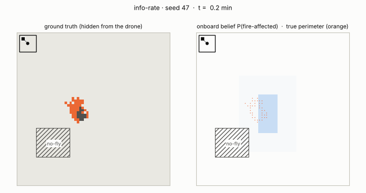
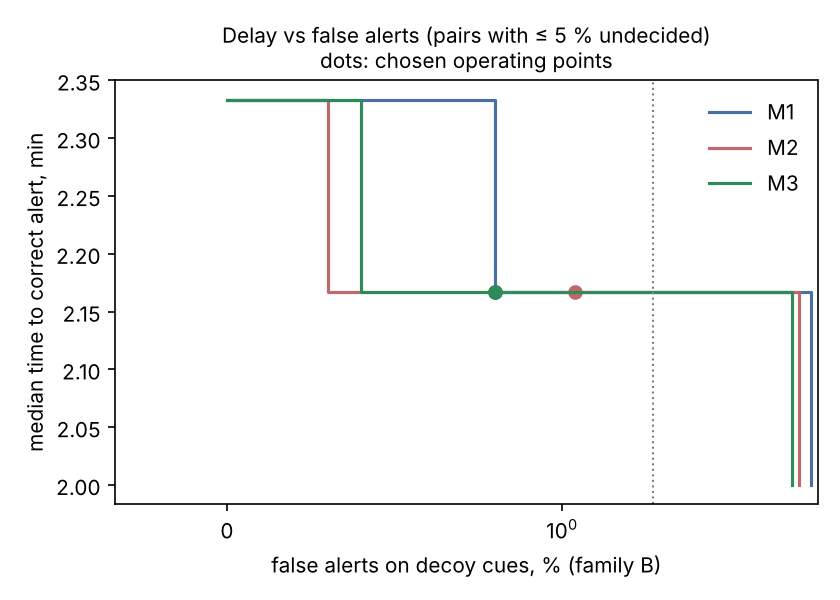

# argus-autonomy

**Active wildfire-front estimation for a single UAV, in simulation.**
A coarse, stale satellite hotspot gives a prior; a nadir thermal camera gives noisy local measurements; a Bayesian occupancy filter fuses both; an information-rate planner decides where to fly next. A geofence and a return-to-base monitor have the final word on every move.

<p align="center"></p>

<sub>Seed 47 is shown because its F1 is the median of the 100 nominal runs. It was picked by `experiments/make_media.py`, not by hand.</sub>

> **Question.** Given a coarse satellite hotspot prior and a noisy onboard thermal sensor, how quickly can a single UAV confirm a wildfire and localise its perimeter with a measurable uncertainty, while staying inside a geofence and keeping enough endurance to return?

This is the autonomy layer of the Argus Aegis wildfire-drone concept. It is a research prototype, **not flight software**: everything runs in a 2-D grid simulation.

Since v2.0 the stack covers the whole chain **detect → confirm → respond**: a cue-free patrol from a dock finds the heat, the decision test below confirms it, and a response layer turns the confirmation into a responder brief, a forecast, and a measured answer to whether a drone from the dock could knock the fire down ([§ v2.0](#v20-detection-and-response-around-the-decision-test)).

## Result in one table

The table shows the nominal condition, 100 Monte Carlo seeds per planner. All planners face *identical* fires on the same seed.

| planner | first confirmation, median | 50 % of burnt area confirmed, median | F1 of map at landing | perimeter error, median |
|---|---|---|---|---|
| lawnmower (full map) | 9.4 min | 15.4 min | 0.829 | 66 m |
| prior-lawnmower (sweeps the satellite hotspot box) | 3.3 min | 6.2 min | 0.878 | 35 m |
| **info-rate (this work)** | **1.8 min** | **3.0 min** | **0.925** | **18 m** |

Against the strongest baseline (prior-lawnmower), paired on identical seeds:
- info-rate confirms the fire earlier in **99/100** seeds (median −1.5 min, Wilcoxon *p* < 10⁻¹⁶);
- its perimeter error is lower in **91/100** seeds.

Cells are 25 m, so a median perimeter error of 18 m is below one cell. Across all 900 benchmark missions there were **0 geofence violations** and **900/900 returns to base**, each with ≥ 7 ticks (70 s) of reserve.

Full table, all three conditions: [`results/summary.md`](results/summary.md).

## Where it breaks (read this part)

Two failure modes are measured, not hidden.

**1. An idealised spread model.** In the `wind-mismatch` condition the estimator assumes calm air while the real fire is wind-driven. Info-rate degrades but still leads:

| | F1 | perimeter error |
|---|---|---|
| info-rate | 0.925 → 0.872 | 18 m → 29 m |
| prior-lawnmower | 0.878 → 0.772 | 35 m → 60 m |

The prediction step alone tells the underlying story. With no observations, the calm-air model recovers only 35 % of the true burnt area after 30 min (IoU 0.28); with wind known it recovers 66 % ([`results/prediction_calibration.md`](results/prediction_calibration.md)). Observations are what make the map good; the model only buys time between them.

**2. Over-trusting the satellite prior.** In `degraded-prior` (older overpass, 6-cell geolocation error), 40/100 overpasses detect nothing. In 42/100 seeds none of the fire lies inside the flagged pixels or the ring around them; 40 of those are the non-detections. A greedy information planner then sees almost no expected gain where the fire actually is:
- info-rate's mean F1 is still the best (0.847);
- but it has **13/100 catastrophic runs** (F1 < 0.7), against 2/100 for the prior-blind lawnmower;
- its F1 is more than 0.02 below the blind lawnmower's in 25/100 seeds.

Tempering the prior fixes most of this. Raising the background prior from 0.002 to 0.01 cuts catastrophic runs from 13 to 3 and costs nothing in nominal conditions (F1 0.925 → 0.929). The fix works, but it is a hand-tuned knob, not a principled treatment of prior misspecification ([`results/prior_tempering.md`](results/prior_tempering.md)).

## Decoys and a calibrated decision (v1.1)

The v1.0 estimator cannot tell a fire from a sunlit rock or a contained burn: to it, a hot spot that stays hot is a fire. A probe with three static decoys confirms at least one as fire in **50/100** missions ([`results/probe_decoys.json`](results/probe_decoys.json)).

v1.1 changes the output from a map to a **decision with a time stamp**: ALERT (*there is a spreading fire, here*) or CLEAR (*nothing in the flagged pixels spreads*). A sequential test between two models, *a fire that spreads* and *things that only stay hot*, makes growth, and the absence of predicted growth, the evidence. The thresholds were then chosen on one set of seeds by a rule fixed in advance, and reported on another set the choice never saw.

<p align="center"></p>

Held-out seeds, M3 (two-model test, CLEAR gate, close look) re-flown on-line at the chosen thresholds:

| | v1.0 | v1.1, thresholds a priori | **v1.1, operating point** |
|---|---|---|---|
| false alert when the satellite cue is a decoy (1000 missions) | 100 %¹ | 1.8 % | **1.2 %** (0.6–2.1) |
| real fire dismissed (1000) | 0 %² | 0.2 % | 0.2 % |
| alert placed on a decoy instead of the fire (1000) | 9.8 %¹ | 0.0 % | 0.0 % |
| median time to correct alert | 1.83 min¹ | 2.17 min | 2.17 min |
| median time to dismiss a decoy cue | — | 4.50 min | 6.00 min |
| geofence violations · returns to base | | 0 · 2000/2000 | 0 · 2000/2000 |

<sub>¹ milestone (i) seeds. ² v1.0 cannot dismiss anything, so it never dismisses a real fire either. Intervals: Clopper–Pearson 95 %.</sub>

What it costs and what it does not fix, measured rather than hidden:
- **The 2 % false-alert target is met in point estimate, not certified.** The upper bound is 2.1 %; 1000 held-out missions cannot certify less, about 2000 could.
- **The remaining missed fires are coverage misses.** In all four (two per seed set) the test statistic never rose above 0.7 before the CLEAR; the fire became visible minutes later. No threshold fixes that. A CLEAR means *nothing spreads in the flagged pixels*, not *no fire*.
- **Overconfidence is real, but not where it was expected.** A pre-registered prediction of orders-of-magnitude overconfidence on decoys was refuted (factor ≈ 2 at the a-priori threshold). The overconfidence that matters sits on the CLEAR side, and the gate (*no CLEAR until every flagged pixel has been seen*) is what contains it ([`media/reliability.png`](media/reliability.png)).
- **Three ideas did not work** and are reported as such: an active-hypothesis-testing planner adds nothing over plain heat search; a close look helps against warm decoys but wastes time on hot ones, because a contained burn differs from a young fire only in growth; a prediction about the H1 prior was refuted.

Every free choice from milestone (ii) on was screened on seeds the benchmark never sees, and each milestone's protocol was committed before it ran. Design, decisions, nine pre-registered expectations (four confirmed, five refuted or not supported) and the full account: [`docs/design/v1.1-decoy-discrimination.md`](docs/design/v1.1-decoy-discrimination.md).

## First contact with real data

Which of the simulation's assumptions can the public satellite record check? A pre-registered analysis of every 2024 VIIRS active-fire detection in Germany, Greece and Portugal (31 000 detections, 12 000 dispatch-sized cues) answers in part ([`docs/design/firms-2024-contact.md`](docs/design/firms-2024-contact.md)):

- **Most decoy cues are already known.** In Germany 71 % of cues are labelled industrial or other static sources, which a dispatcher masks before any drone flies. The drone's problem is the residual.
- **The residual is not empty.** At least 15 % (Germany), 6 % (Greece) and 1 % (Portugal) of the remaining cues sit on sites seen on 10 or more days, mostly at night, like unflagged industrial sources. Contained burns are invisible to this data, so these are lower bounds.
- **Real cues are 2–6.5 times larger than simulated ones, and this matters, but not as predicted.** Re-run with 400 m satellite pixels ([`docs/design/robustness-viirs-pixel.md`](docs/design/robustness-viirs-pixel.md)): false alerts on decoy cues fall to 0 of 1000 and dismissal gets faster, but real fires dismissed rise from 2 to 6 of 1000 at the operating point (from 2 to 13 at the a-priori thresholds). A larger cue yields cold evidence faster, so the drone dismisses it before searching the ring where the fire lies. The operating point does not transfer across satellite geometries; coverage misses are the open problem for v1.2.
- **No pre-registered expectation held in all three countries.** One failed because the protocol was wrong: static sources are visible almost only at night. One inference drawn from the data, that dismissal would get slower, was refuted by the re-run. All of it is reported.

## v1.2: coverage misses, adopted on the second attempt

The remaining error after v1.1 was the *coverage miss*: a fire just outside the flagged satellite pixel, dismissed before the drone had looked there. Ring-aware CLEAR rules were tested in two pre-registered rounds across 200 m and 400 m satellite pixels, each time on held-out seeds never flown before ([`docs/design/v1.2-coverage-misses.md`](docs/design/v1.2-coverage-misses.md)).

- **First round: not adopted.** The chosen rule caught every coverage miss but missed two other fires, and broke the bound on undecided missions. The cause was the selection procedure. When 144 thresholds tie at zero misses, a speed tie-break picks the least vetted one.
- **Second round: adopted.** The selection rule was corrected to take the most conservative threshold among tied pairs and to keep a margin on undecided missions. It was then pre-registered with an adoption criterion and run on fresh seeds. The chosen rule (D5: search the ring for 5 minutes before any CLEAR) met all four expectations and the criterion:

| fresh held-out seeds, 1000 per row | v1.1 rule, 400 m | **D5, 400 m** | v1.1 rule, 200 m | D5, 200 m |
|---|---|---|---|---|
| real fires dismissed | 4 | **0** | 1 | 1 |
| false alerts on decoy cues | 0.6 % | 0.7 % | 1.1 % | 1.1 % |
| median time to dismiss a decoy | 8.2 min | 10.7 min | 7.3 min | 9.5 min |

Both rules run at thresholds re-selected under the corrected procedure, so the v1.1 columns are the v1.1 *rule*, not the v1.1 release's operating point. The evidence for fewer missed fires is weak (5 against 1 over both geometries; p = 0.12 at 400 m). The gain appears only with realistic, large pixels, and it costs about 2.5 minutes per false alarm. `RECOMMENDED` in [`config.py`](src/argus_autonomy/config.py) holds the adopted configuration. Defaults are unchanged so that published results reproduce.

## v1.3: an object-level fire hypothesis (measured, not adopted)

D5 compensates for coverage misses by searching longer. v1.3 removes their cause. The fire hypothesis becomes "the world of H0 plus one fire at an unknown location", a mixture over about 40–170 location hypotheses. Cold looks at the cue then shift belief toward the ring instead of against fire as a whole, and a unit test fixes this bound exactly ([`docs/design/v1.3-object-level-fire.md`](docs/design/v1.3-object-level-fire.md)). The test was pre-registered against D5, on fresh seeds:

| fresh held-out seeds, 1000 per cell | D5, 200 m | **object model, 200 m** | D5, 400 m | object model, 400 m |
|---|---|---|---|---|
| real fires dismissed | 1 | 1 | 1 | 1 |
| false alerts on decoy cues | 1.4 % | 0.6 % | 0.6 % | 0.2 % |
| median time to correct alert | 2.17 min | 1.67 min | 2.17 min | 1.83 min |
| median time to dismiss a decoy | 9.50 min | **7.17 min** | 10.67 min | **14.50 min** |

All four expectations held, but the pre-registered adoption criterion did not: at VIIRS-sized pixels the object model is 3.8 min slower to dismiss a decoy, because it will not dismiss until the ring is actually searched. D5 therefore stays `RECOMMENDED`.

At 200 m pixels the object model is better on every measured dimension. Using it for fine satellite products is a hypothesis for a new pre-registered test, not a result. The one fire both methods miss is 3 cells, far smaller than the model's assumed fire. That points to the next step: uncertainty over fire size as well as location.

## v2.0: detection and response around the decision test

Two new layers sit on either side of the v1.2b decision test, which is reused unchanged ([`docs/design/v2.0-detect-respond.md`](docs/design/v2.0-detect-respond.md)). Ten expectations were committed before any held-out run; nine held.

**Detect** ([`detection.py`](src/argus_autonomy/detection.py)). No satellite cue: the fire ignites at an unknown time and place on a risk map. One drone patrols from a dock, lands and recharges. A patrol filter with an ignition hazard makes unseen ground gradually worth revisiting. A confident hot spot is handed to the decision test; a CLEAR registers it as a static source.

| median minutes from ignition to correct ALERT (200 fires per cell) | 0.64 km² | 1.44 km² | 2.56 km² |
|---|---|---|---|
| lawnmower patrol, 1 drone (30 min recharge) | 21.2 | 34.1 | 52.2 |
| **information-rate patrol on the risk map, 1 drone** | **13.7** | **24.8** | **31.2** |
| information-rate patrol, continuous coverage (two drones alternating) | **7.2** | 12.7 | 16.7 |

- The risk-aware patrol beats the lawnmower on 145 of 200 paired fires.
- On fire-free maps there was 1 false ALERT in 558 hand-offs (upper bound 1.0 %).
- There were 0 geofence violations in 5000 patrols.
- **A 10-minute detection target is met only with continuous coverage and about 0.64 km² per dock.** Once the drone is over the fire, confirmation takes about a minute; the rest is revisit time.

**Respond** ([`response.py`](src/argus_autonomy/response.py), [`suppression.py`](src/argus_autonomy/suppression.py)).
- *Brief and forecast.* At ALERT the estimator's belief becomes a brief: position, area, extent, heading and distance from the dock. It comes with an ensemble forecast of the affected area at +15 and +30 min. The ensemble beats the estimator's own prediction on Brier score in 332 of 396 alerts, and its envelope contains every truly affected cell, but it over-predicts the area about 2.5×.
- *Can a drone from the dock knock it down?* A closed-form model answers this, because the 25 m grid is too coarse to simulate suppression. It combines Byram intensity and flame length, Anderson's fire shape, Penney et al.'s critical water flow and a momentum-theory multirotor. Coupled to the patrol's measured latencies for slow fires (~2 m/min), one 40 L drone contains the fire in **2 %** of cases, and two drones with continuous coverage in **8 %**. Doubling pack energy changes nothing, because payload is not the constraint: in the model, a 2 m/min fire must be alerted within about 10 min and lie within about 1 km of the dock.

**Where it breaks.** Slow fires are where a payload could matter, and they are also where the test is weakest. Their growth is the test's only evidence, so confirmation takes about 12 min instead of 1, and 0.5–1.5 % of real slow fires were CLEARed. Suppression therefore remains a research item, and nothing here claims autonomous fire suppression. The measured product of the response layer is the brief and the forecast.

## Method

| component | what it does | file |
|---|---|---|
| Fire | Stochastic cellular automaton with wind (exp(k·cos θ) anisotropy), correlated fuel field and burn-out | [`world.py`](src/argus_autonomy/world.py) |
| Satellite prior | 8×8-cell pixels (200 m), detection threshold, latency, geolocation error | [`perception.py`](src/argus_autonomy/perception.py) |
| Sensor | 7×7-cell footprint, P(detect) = 0.85, P(false alarm) = 0.03, independent cells | [`perception.py`](src/argus_autonomy/perception.py) |
| Filter | Exact log-odds Bayes update. Gated mean-field prediction through the estimator's own spread model: only cells with *b* ≥ 0.5 spread, because ungated mean-field over-predicts the burnt area 4.7× after 30 min | [`perception.py`](src/argus_autonomy/perception.py) |
| Planner | Expected information gain *G(c)* = Σ over the footprint of the mutual information I(X;Z); flies to argmax *G(c)* / (travel ticks + τ) | [`planners.py`](src/argus_autonomy/planners.py) |
| Safety | Geodesic routing around the no-fly zone (no corner cutting). Waypoints are accepted only if the drone can still reach base with reserve; return-to-base is forced when the margin runs out | [`safety.py`](src/argus_autonomy/safety.py) |

The [technical report](docs/report/report.pdf) gives the equations, the experimental protocol and the failure analysis for v1.0–v1.1 in full. Later versions are documented in their design documents under [`docs/design/`](docs/design/), each with its pre-registered protocol and results.

## Run it

```bash
pip install -e ".[dev]"          # Python ≥ 3.10; numpy, scipy (+ matplotlib, imageio for figures)
pytest -q                        # 92 tests: Bayes update, regression invariants, geofence, RTB, first passage, v2.0 layers

argus-demo --planner info-rate --seed 47 --gif mission.gif
argus-demo --planner prior-lawnmower --condition degraded-prior --seed 68

python experiments/run_benchmark.py --seeds 100          # ~1 min on 2 cores → results/, media/
python experiments/calibrate_prediction.py --seeds 50
python experiments/ablation_prior_tempering.py --seeds 100
python experiments/make_media.py

# v1.1: decoys, threshold sweep, operating point (about an hour on 2 cores)
python experiments/run_decoy_benchmark.py
python experiments/run_decoy_benchmark_ii.py
python experiments/run_sweep.py --split select && (cd experiments && python analyse_sweep.py --split select)
python experiments/run_sweep.py --split heldout && (cd experiments && python analyse_sweep.py --split heldout)
(cd experiments && python run_operating_point.py)

# v2.0: detection and response (about 50 min on 2 cores)
(cd experiments && python v20.py patrol && python v20.py forecast && python v20.py report)
```

Every number in this README and in the report comes from the files these scripts write. Results are deterministic for a given seed.

## Scope and honest limitations

- **2-D grid world.** No vehicle dynamics, wind on the aircraft, terrain, smoke occlusion or communication loss.
- **Independent per-cell sensor noise; illustrative sensor and decoy numbers.** v1.1 models persistent decoys, but the class-conditional sensor rates and the decoy mix are assumptions, not measurements. The results describe the method's behaviour, not field performance.
- **Toy fire model.** It is not Rothermel/FARSITE, and the spread parameters are not fitted to real fire data.
- **Simple safety monitor.** It is a checkable runtime invariant on a grid, not a formal reachability guarantee for continuous dynamics.
- **One vehicle and a greedy one-step planner.** There is no multi-step lookahead and no multi-UAV coordination.
- **One fire per scenario, static decoys.** Several simultaneous fires and moving heat sources are out of scope.
- **Suppression is a feasibility model, not a simulation.** Its fire growth, water demand and airframe are closed-form with stated assumption ranges, and the airframe is deliberately optimistic. Airspace, BVLOS authorisation and deconfliction with manned firefighting aircraft are not modelled.

## Citation

See [`CITATION.cff`](CITATION.cff). Releases are archived on Zenodo:

- all versions (concept DOI, resolves to the latest): [10.5281/zenodo.23326083](https://doi.org/10.5281/zenodo.23326083)
- v2.0.0: [10.5281/zenodo.23496556](https://doi.org/10.5281/zenodo.23496556)
- v1.1.0: [10.5281/zenodo.23438763](https://doi.org/10.5281/zenodo.23438763)

Cite the version DOI when a result must be reproducible; the numbers in this README belong to v2.0.0.

## License

Apache-2.0, see [`LICENSE`](LICENSE).
